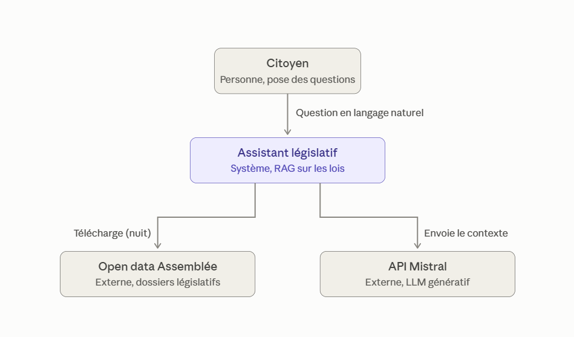

# Assistant législatif (RAG, 17e législature)

Répond en français aux questions sur les dossiers législatifs de l'Assemblée nationale (open data, 17e législature) : « Quelles lois ont été promulguées récemment ? », « Où en est le texte sur la fin de vie ? ».

- Réponses tirées **uniquement** des fiches des dossiers, avec le lien de chaque dossier cité ; sinon « Je ne sais pas ».
- **Neutralité** politique : faits, dates, étapes, votes, sans opinion.
- **Indicateur de confiance** calculé par le code : un lien, une date ou un n° de loi absent des fiches est signalé comme inventé.

Prototype pédagogique (M2 Ynov, projet fil rouge). Avancement et suite : [ROADMAP.md](ROADMAP.md).

## Architecture



Diagrammes [niveau 2 (conteneurs)](architecture-c4-model/c4-model-niveau-2.png) et [niveau 3 (composants)](architecture-c4-model/c4-model-niveau-3.png).

**Pipeline de données** (`pipeline.py`, chaque nuit), une couche = un dossier :

| Couche | Code | Écrit dans |
|---|---|---|
| 1. Extraire : ZIP open data de l'AN | `app/sources/` | `data/raw/` |
| 2. Transformer : dossier → fiche texte + métadonnées (dates, statut déduit) | `app/transform/` | `data/processed/dossiers.jsonl` |
| 3. Contrôler : schéma, dates, volume comparé au lot précédent ; un contrôle bloquant conserve la base actuelle | `app/qualite.py` | `data/qualite/` |
| 4. Stocker : embeddings e5 (ONNX) → ChromaDB | `app/stockage/` | `chroma_db/` |

**Question** (`app/rag.py`, commun à l'API et au chat) :

1. `filters.py` : période (« récemment » = 90 jours), statut et thème extraits par regex ;
2. `retriever.py` : 5 fiches, par recherche sémantique sur le thème ou la question, ou les plus récentes pour une liste temporelle ;
3. `prompt.py` : 7 règles (fiches seules, « Je ne sais pas », liens, neutralité) + date du jour + fiches ;
4. `llm_client.py` : LLM via une API compatible OpenAI : Qwen3.8-27B via Hugging Face (Academia Hub de l'école), ou Mistral `ministral-14b-latest` ;
5. `confiance.py` : contrôle d'ancrage de la réponse ; sources construites par le code, pas par le LLM ;
6. `journal.py` (JSONL) et `suivi.py` (MLflow) : chaque question, sa réponse, sa latence, puis l'avis 👍/👎.

## Installation

Python 3.12.

```bash
python -m venv .venv
.venv\Scripts\activate          # Windows ; Linux/macOS : source .venv/bin/activate
pip install -r requirements.txt
cp .env.example .env            # puis renseigner LLM_API_KEY : token Hugging Face (https://huggingface.co/settings/tokens) ou clé Mistral
```

Le modèle d'embeddings (~1,1 Go) est téléchargé au premier lancement, puis lu sur le disque. Il reste en local : Hugging Face ne sert pas e5-base en vecteurs, et e5-large, qui l'est, classe moins bien (20/31).

Avec Hugging Face, `HF_BILL_TO` facture le budget étudiant de l'école et `LLM_REASONING_EFFORT=none` coupe la réflexion de Qwen3 (sinon elle épuise les tokens et la réponse arrive vide) : voir `.env.example`.

## Lancement

```bash
python pipeline.py                            # construit la base (téléchargement + indexation, quelques minutes)
uvicorn app.main:app --reload                 # API : http://127.0.0.1:8000/docs
chainlit run chainlit_app.py -w --port 8001   # chat : http://localhost:8001
```

API : `POST /ask` (`{"question": "..."}`), `POST /feedback` (avis sur une réponse), `GET /health`.

Options du pipeline : `--sans-telechargement`, `--etape extraire|transformer|controler|stocker`, `--forcer` (indexe malgré un contrôle bloquant, après vérification humaine).

Suivi MLflow (optionnel) : lancer le serveur avec la commande donnée dans `.env.example`, puis http://localhost:5000. Sans `MLFLOW_TRACKING_URI`, le suivi est désactivé.

### Docker

Une seule image pour les trois usages ; la clé API et les données restent hors de l'image.

```bash
docker build -t assistant-legislatif:0.4.0 .
docker run --no-healthcheck --env-file .env -v donnees:/app/data -v base:/app/chroma_db assistant-legislatif:0.4.0 python pipeline.py
docker run -d -p 8000:8000 --env-file .env -v donnees:/app/data -v base:/app/chroma_db assistant-legislatif:0.4.0
docker run -d -p 8001:8001 --no-healthcheck --env-file .env -v donnees:/app/data -v base:/app/chroma_db assistant-legislatif:0.4.0 chainlit run chainlit_app.py --host 0.0.0.0 --port 8001 --headless
```

Depuis un conteneur, MLflow s'atteint par `MLFLOW_TRACKING_URI=http://host.docker.internal:5000`.

## Évaluation

```bash
python -m unittest discover tests -v   # tests unitaires, sans LLM ni base (lancés aussi par GitHub Actions à chaque push)
python evaluate.py                     # 31 questions de cas_evaluation.json (LLM et base requis)
python evaluate.py --neutralite        # les 16 questions orientées seulement
python evaluate.py --juge              # en plus : un LLM juge relit chaque réponse
python analyse_logs.py --jours 7       # vraies questions du journal : confiance, avis, latence
```

`evaluate.py` mesure, pour chaque question de la base de test de référence (`cas_evaluation.json`) : le retriever (dossier attendu en 1re position, ou critères d'une liste), la réponse (lien et faits attendus, ou « Je ne sais pas »), la fuite des consignes, la neutralité (opinions, termes chargés, paires de questions miroir) et la latence. Résultats dans `evaluation_resultats.json` et dans MLflow.

Dernier résultat (16/10/2026, Qwen3.8-27B via Hugging Face) : **29/31** questions réussies, retriever 92 %, latence médiane 0,6 s (Mistral, 15/10/2026 : 29/31, 2,1 s).

**LLM juge** (`python evaluate.py --juge`, `app/juge.py`) : un second modèle d'une autre famille, `google/gemma-4-31B-it` (`LLM_JUGE_MODEL`), relit chaque réponse avec ce que l'assistant a reçu et rend trois verdicts oui / non : **fidèle** (chaque fait est dans les fiches et attribué à la bonne étape), **pertinente**, **neutre**. Suivi à part : il ne change pas le score. 16/10/2026 : 26/26 réponses jugées fidèles, pertinentes et neutres (5 questions en 429) ; contrôle sur des réponses volontairement fausses : date déplacée, jugement ajouté et « Je ne sais pas » injustifié sont tous détectés. ~2 400 tokens par verdict.

## Limites

- **Statut déduit** des actes par une heuristique (`calculer_statut`) : absent des données de l'AN.
- **Pas le texte des lois** : seulement la fiche du dossier (titre, statut, dates, étapes clés).
- **Listes non exhaustives** : 5 fiches au plus par question ; le LLM le précise.
- **Filtres par regex** : « récemment » vaut 90 jours ; une formulation imprévue n'est pas filtrée.
- **Confiance** : vérifie que chaque fait cité existe dans les fiches, pas qu'il est attribué à la bonne étape. Les réponses restent à vérifier sur le site de l'Assemblée.
- **Ingestion** : la base est vide pendant la reconstruction (1 à 3 min).
- **Limite de débit du fournisseur** (Cerebras via Hugging Face) : des questions en rafale peuvent recevoir une erreur 429 ; observé sur certains passages de `evaluate.py`.
- **Pas encore d'authentification** ni de filtre de données personnelles (itération 7 de la roadmap).
